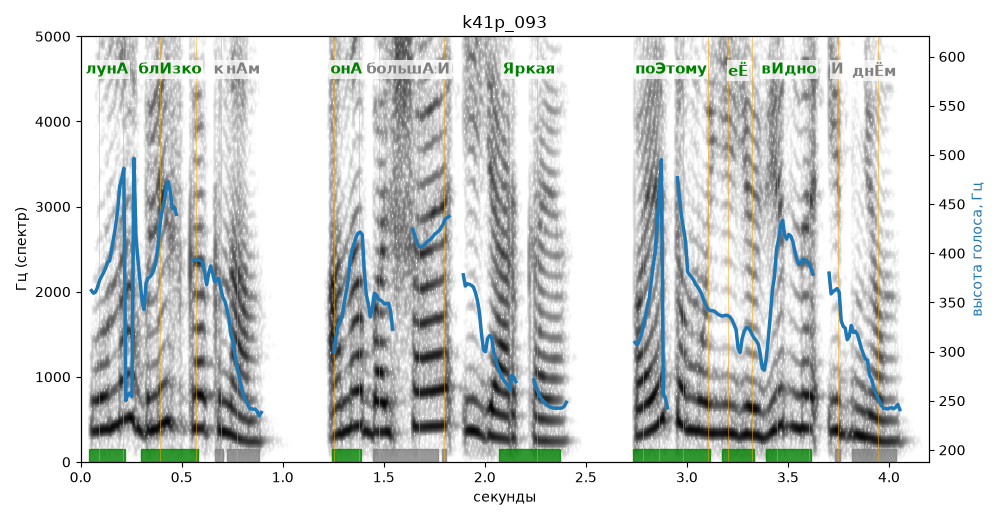

# k41p_093

Эталон: Луна близко к нам. Она большая и яркая. Поэтому её видно и днём.
Распознано: Уна близко к нам, она большая и яркая, поэтому ее видно и бнем.
Расхождения в словах: «луна» → «уна»; «днем» → «бнем»

## Ударения
(где нужно: ruaccent)

| слово | нужно | у голоса | |
|---|---|---|---|
| луна | лунА | лунА | ✓ |
| близко | блИзко | блИзко | ✓ |
| она | онА | онА | ✓ |
| большая | большАя | — | ? |
| яркая | Яркая | Яркая | ✓ |
| поэтому | поЭтому | поЭтому | ✓ |
| её | еЁ | еЁ | ✓ |
| видно | вИдно | вИдно | ✓ |

## Интонация
- ✓ «луна близко к нам.» — конец фразы понижается — звучит законченно
- ✓ «она большая и яркая.» — конец фразы понижается — звучит законченно
- ✓ «поэтому её видно и днём.» — конец фразы понижается — звучит законченно
- Диапазон голоса 10.5 полутонов (живо), средняя высота 350 Гц

## Паузы и темп
- паузы на своих местах
- Темп 7.3 слога/с (быстро)

_Синяя линия — высота голоса. Над словами заглавная буква — где ударение должно быть; красным — голос поставил не туда (уверенно), оранжевым — возможно._
