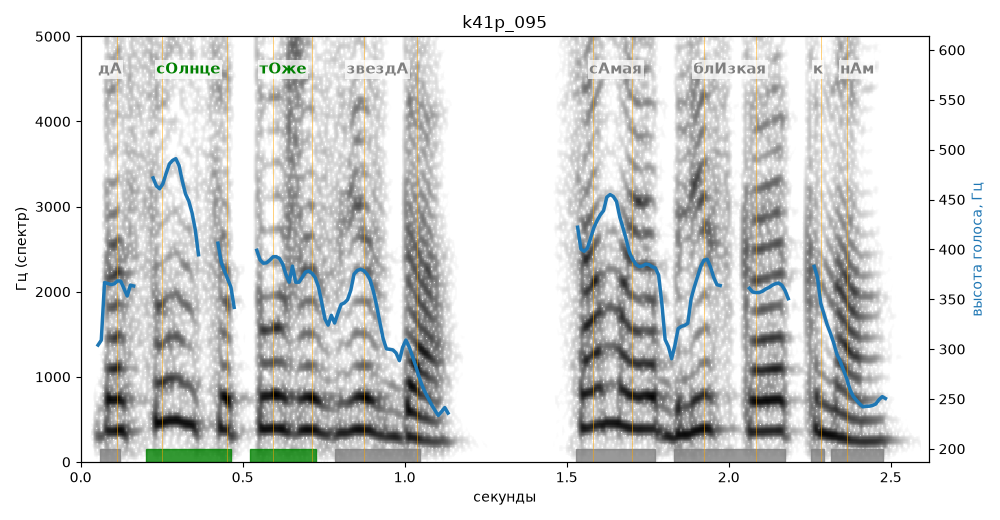

# k41p_095

Эталон: Да! Солнце тоже звезда. Самая близкая к нам.
Распознано: До сунца тоже звезда. Самая близкая к нам.
Расхождения в словах: «да солнце» → «до сунца»

## Ударения
(где нужно: ruaccent)

| слово | нужно | у голоса | |
|---|---|---|---|
| солнце | сОлнце | сОлнце | ✓ |
| тоже | тОже | тОже | ✓ |
| звезда | звездА | звЕзда | ? не разобрать |
| самая | сАмая | — | ? |
| близкая | блИзкая | — | ? |

## Интонация
- ✓ «солнце тоже звезда.» — конец фразы понижается — звучит законченно
- ✓ «самая близкая к нам.» — конец фразы понижается — звучит законченно
- Диапазон голоса 11.1 полутонов (живо), средняя высота 364 Гц

## Паузы и темп
- после «да!» пауза всего 0.08 с — фразы слипаются
- Темп 6.7 слога/с (быстро)

_Синяя линия — высота голоса. Над словами заглавная буква — где ударение должно быть; красным — голос поставил не туда (уверенно), оранжевым — возможно._
