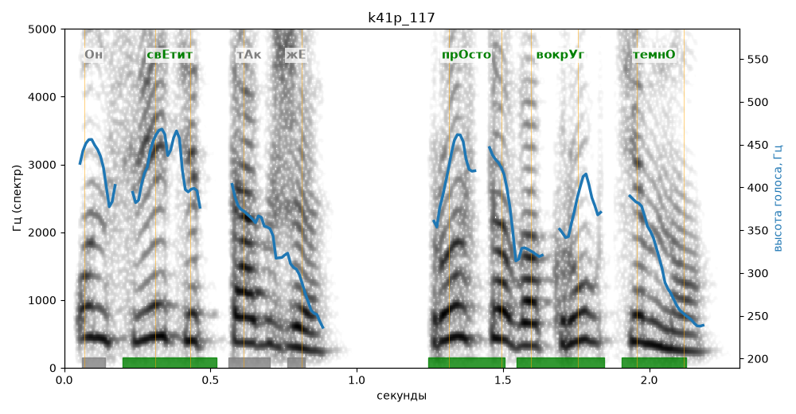

# k41p_117

Эталон: Он светит так же. Просто вокруг темно.
Распознано: Он светит также, просто вокруг темно.
Расхождения в словах: «так же» → «также»

## Ударения
(где нужно: ruaccent)

| слово | нужно | у голоса | |
|---|---|---|---|
| светит | свЕтит | свЕтит | ✓ |
| просто | прОсто | прОсто | ✓ |
| вокруг | вокрУг | вокрУг | ✓ |
| темно | темнО | темнО | ✓ |

## Интонация
- ✓ «он светит так же.» — конец фразы понижается — звучит законченно
- ✓ «просто вокруг темно.» — конец фразы понижается — звучит законченно
- Диапазон голоса 10.6 полутонов (живо), средняя высота 377 Гц

## Паузы и темп
- паузы на своих местах
- Темп 6.7 слога/с (быстро)

_Синяя линия — высота голоса. Над словами заглавная буква — где ударение должно быть; красным — голос поставил не туда (уверенно), оранжевым — возможно._
