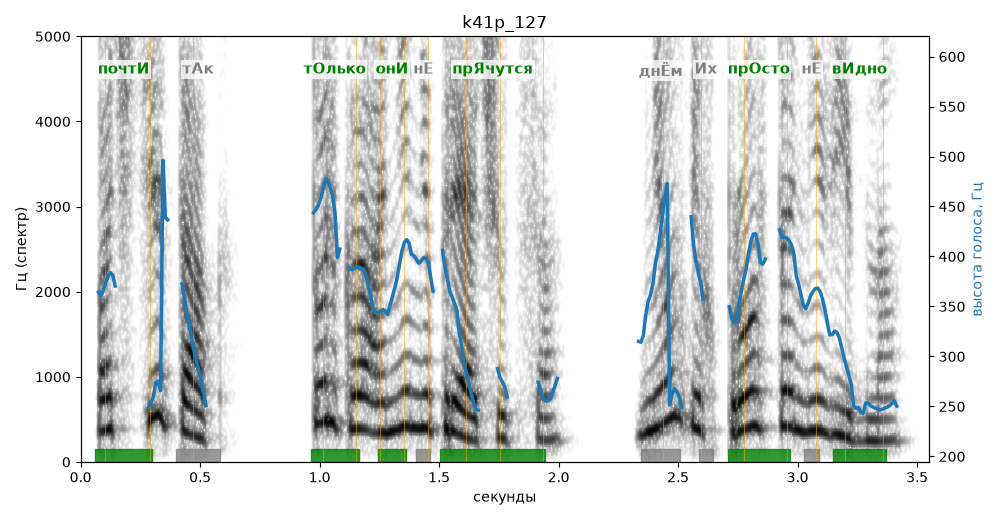

# k41p_127

Эталон: Почти так. Только они не прячутся. Днём их просто не видно.
Распознано: почти так, только они не приочудся, в нем их просто невидно.
Расхождения в словах: «прячутся днем» → «приочудся в нем»; «не видно» → «невидно»

## Ударения
(где нужно: ruaccent)

| слово | нужно | у голоса | |
|---|---|---|---|
| почти | почтИ | почтИ | ✓ |
| только | тОлько | тОлько | ✓ |
| они | онИ | онИ | ✓ |
| прячутся | прЯчутся | прЯчутся | ✓ |
| просто | прОсто | прОсто | ✓ |
| видно | вИдно | вИдно | ✓ |

## Интонация
- ✗ «почти так.» — конец фразы не понижается — звучит незаконченно / как перечисление
- ✓ «только они не прячутся.» — конец фразы понижается — звучит законченно
- ✓ «днём их просто не видно.» — конец фразы понижается — звучит законченно
- Диапазон голоса 10.2 полутонов (живо), средняя высота 357 Гц

## Паузы и темп
- паузы на своих местах
- Темп 7.1 слога/с (быстро)

_Синяя линия — высота голоса. Над словами заглавная буква — где ударение должно быть; красным — голос поставил не туда (уверенно), оранжевым — возможно._
