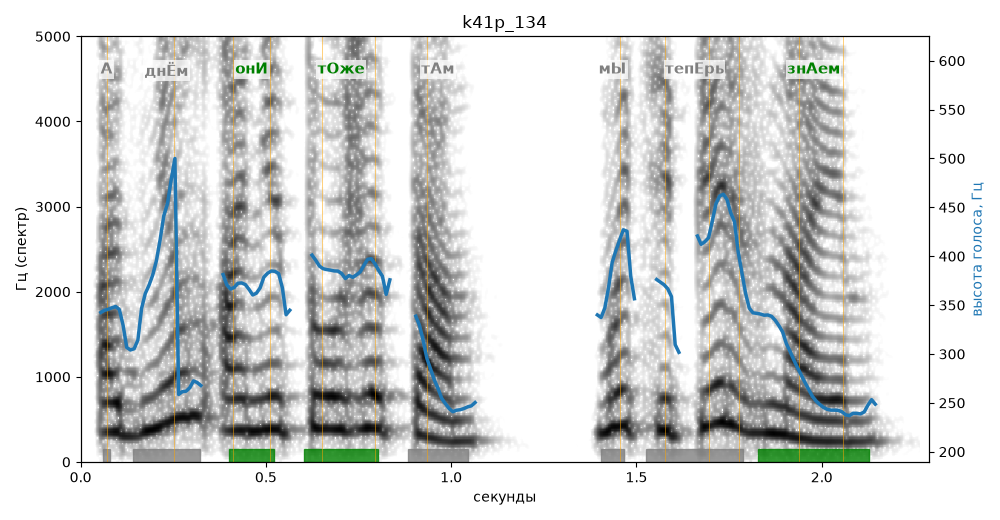

# k41p_134

Эталон: А днём они тоже там. Мы теперь знаем.
Распознано: Одним они тоже там, мы теперь знаем.
Расхождения в словах: «а днем» → «одним»

## Ударения
(где нужно: ruaccent)

| слово | нужно | у голоса | |
|---|---|---|---|
| они | онИ | онИ | ✓ |
| тоже | тОже | тОже | ✓ |
| теперь | тепЕрь | — | ? |
| знаем | знАем | знАем | ✓ |

## Интонация
- ✓ «а днём они тоже там.» — конец фразы понижается — звучит законченно
- ✓ «мы теперь знаем.» — конец фразы понижается — звучит законченно
- Диапазон голоса 10.5 полутонов (живо), средняя высота 347 Гц

## Паузы и темп
- паузы на своих местах
- Темп 7.6 слога/с (быстро)

_Синяя линия — высота голоса. Над словами заглавная буква — где ударение должно быть; красным — голос поставил не туда (уверенно), оранжевым — возможно._
