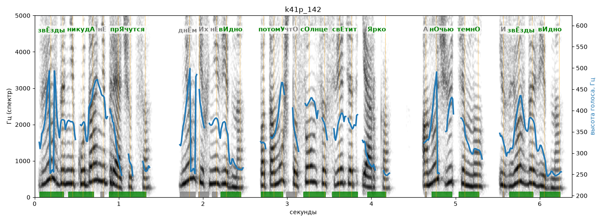

# k41p_142

Эталон: Звёзды никуда не прячутся. Днём их не видно, потому что солнце светит ярко. А ночью темно, и звёзды видно.
Распознано: Звезды никуда не прячутся. Днём их не видно, потому что солнце светит ярко. Оно чью темно, и звезды видно.
Расхождения в словах: «а ночью» → «оно чью»

## Ударения
(где нужно: ruaccent)

| слово | нужно | у голоса | |
|---|---|---|---|
| звёзды | звЁзды | звЁзды | ✓ |
| никуда | никудА | никудА | ✓ |
| прячутся | прЯчутся | прЯчутся | ✓ |
| видно | вИдно | вИдно | ✓ |
| потому | потомУ | потомУ | ✓ |
| солнце | сОлнце | сОлнце | ✓ |
| светит | свЕтит | свЕтит | ✓ |
| ярко | Ярко | Ярко | ✓ |
| ночью | нОчью | нОчью | ✓ |
| темно | темнО | темнО | ✓ |
| звёзды | звЁзды | звЁзды | ✓ |
| видно | вИдно | вИдно | ✓ |

## Интонация
- ✓ «звёзды никуда не прячутся.» — конец фразы понижается — звучит законченно
- ✓ «днём их не видно потому что солнце светит ярко.» — конец фразы понижается — звучит законченно
- ✓ «а ночью темно и звёзды видно.» — конец фразы понижается — звучит законченно
- Диапазон голоса 10.3 полутонов (живо), средняя высота 352 Гц

## Паузы и темп
- паузы на своих местах
- Темп 6.7 слога/с (быстро)

_Синяя линия — высота голоса. Над словами заглавная буква — где ударение должно быть; красным — голос поставил не туда (уверенно), оранжевым — возможно._
