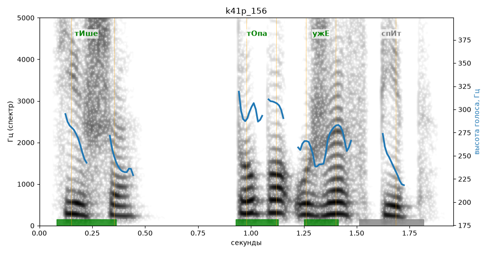

# k41p_156

Эталон: Тише. Топа уже спит.
Распознано: Тиша, туба уже спит.
Расхождения в словах: «тише топа» → «тиша туба»

## Ударения
(где нужно: ruaccent)

| слово | нужно | у голоса | |
|---|---|---|---|
| тише | тИше | тИше | ✓ |
| топа | тОпа | тОпа | ✓ |
| уже | ужЕ | ужЕ | ✓ |

## Интонация
- ✓ «топа уже спит.» — конец фразы понижается — звучит законченно
- Диапазон голоса 5.1 полутонов (нормально), средняя высота 266 Гц

## Паузы и темп
- паузы на своих местах
- Темп 6.0 слога/с (нормально)

_Синяя линия — высота голоса. Над словами заглавная буква — где ударение должно быть; красным — голос поставил не туда (уверенно), оранжевым — возможно._
