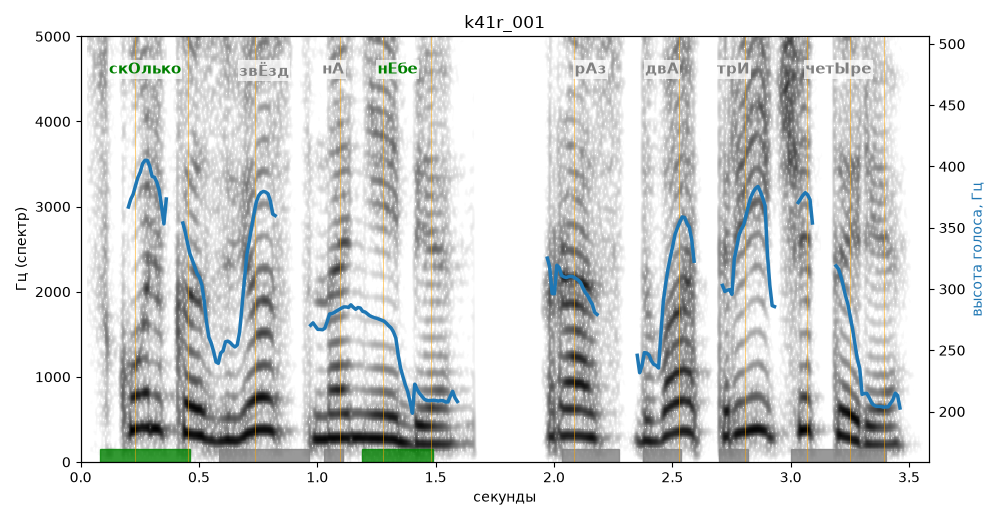

# k41r_001

Эталон: Сколько звёзд на небе! Раз, два, три, четыре…
Распознано: Сколько звезд на небе? Раз, два, три, четыре.
Слова: все совпали

## Ударения
(где нужно: ruaccent)

| слово | нужно | у голоса | |
|---|---|---|---|
| сколько | скОлько | скОлько | ✓ |
| небе | нЕбе | нЕбе | ✓ |
| четыре | четЫре | четырЕ | ? не разобрать |

## Интонация
- ✓ «сколько звёзд на небе!» — выделено слово «сколько» (+4.8 пт)
- ✓ «раз два три четыре…» — конец фразы понижается — звучит законченно
- Диапазон голоса 10.5 полутонов (живо), средняя высота 286 Гц

## Паузы и темп
- паузы на своих местах
- Темп 4.9 слога/с (нормально)

_Синяя линия — высота голоса. Над словами заглавная буква — где ударение должно быть; красным — голос поставил не туда (уверенно), оранжевым — возможно._
