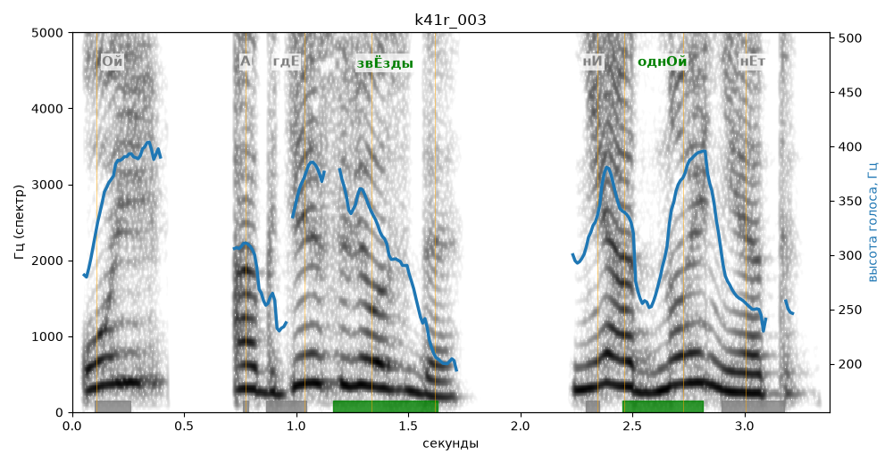

# k41r_003

Эталон: Ой! А где звёзды? Ни одной нет!
Распознано: Ой, а где звезды? Не одной, нет.
Расхождения в словах: «ни» → «не»

## Ударения
(где нужно: ruaccent)

| слово | нужно | у голоса | |
|---|---|---|---|
| звёзды | звЁзды | звЁзды | ✓ |
| одной | однОй | однОй | ✓ |

## Интонация
- ✗ «а где звёзды?» — нет вопросительного подъёма (самое высокое место — «где», в начале) — звучит как утверждение
- ✓ «ни одной нет!» — выделено слово «одной» (+2.2 пт)
- Диапазон голоса 10.5 полутонов (живо), средняя высота 316 Гц

## Паузы и темп
- паузы на своих местах
- Темп 4.7 слога/с (нормально)

_Синяя линия — высота голоса. Над словами заглавная буква — где ударение должно быть; красным — голос поставил не туда (уверенно), оранжевым — возможно._
