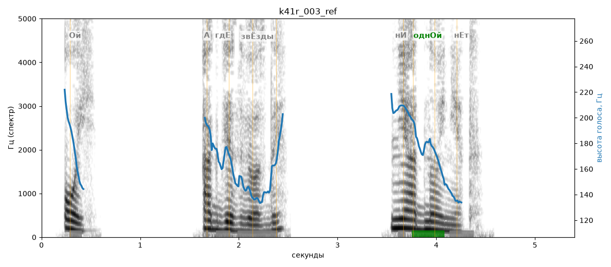

# k41r_003_ref

Голос: **edge:ru-RU-SvetlanaNeural** · длительность 5.4 с
Эталон: Ой! А где звёзды? Ни одной нет!
Распознано: Ой! А где звезды? Не одной нет.
Расхождения в словах: «ни» → «не»

## Ударения
(где нужно: ruaccent)

| слово | нужно | у голоса | |
|---|---|---|---|
| звёзды | звЁзды | звёздЫ | ? не разобрать |
| одной | однОй | однОй | ✓ |

## Интонация
- ✗ «а где звёзды?» — нет вопросительного подъёма (самое высокое место — «а», в начале) — звучит как утверждение
- ✓ «ни одной нет!» — выделено слово «ни» (+2.3 пт)
- Диапазон голоса 7.5 полутонов (живо), средняя высота 168 Гц

## Паузы и темп
- паузы на своих местах
- Темп 5.6 слога/с (нормально)

_Синяя линия — высота голоса. Над словами заглавная буква — где ударение должно быть; красным — голос поставил не туда (уверенно), оранжевым — возможно._
