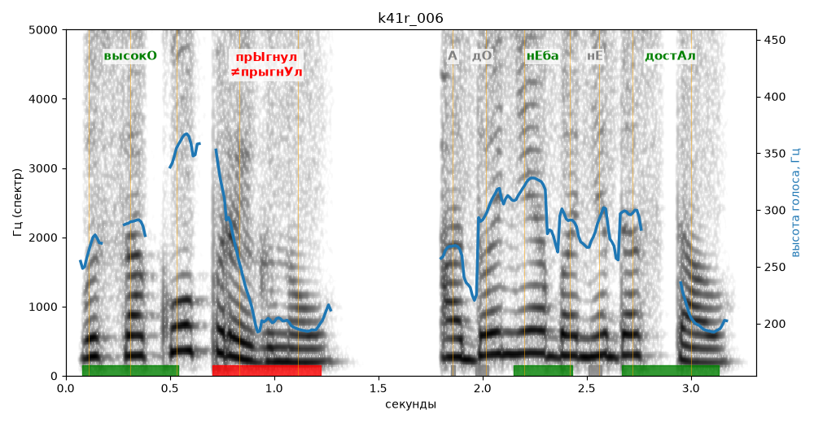

# k41r_006

Эталон: Высоко прыгнул. А до неба не достал.
Распознано: Высоко прыгнул, а донябан не достал.
Расхождения в словах: «до неба» → «донябан»

## Ударения
(где нужно: ruaccent)

| слово | нужно | у голоса | |
|---|---|---|---|
| высоко | высокО | высокО | ✓ |
| прыгнул | прЫгнул | прыгнУл | ✗ ОШИБКА |
| неба | нЕба | нЕба | ✓ |
| достал | достАл | достАл | ✓ |

## Интонация
- ✓ «высоко прыгнул.» — конец фразы понижается — звучит законченно
- ✓ «а до неба не достал.» — конец фразы понижается — звучит законченно
- Диапазон голоса 10.2 полутонов (живо), средняя высота 272 Гц

## Паузы и темп
- паузы на своих местах
- Темп 5.3 слога/с (нормально)

_Синяя линия — высота голоса. Над словами заглавная буква — где ударение должно быть; красным — голос поставил не туда (уверенно), оранжевым — возможно._
