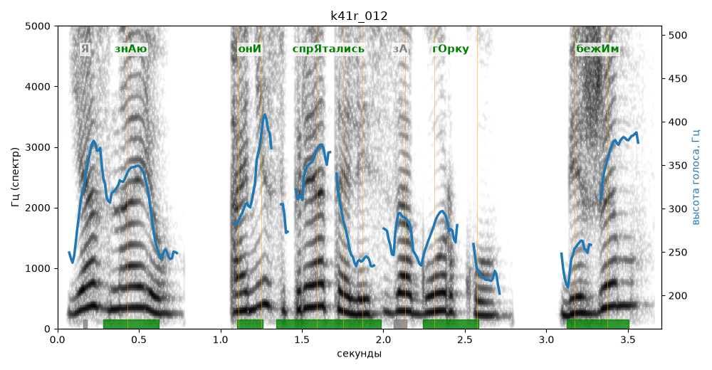

# k41r_012

Эталон: Я знаю! Они спрятались за горку! Бежим!
Распознано: Я знаю, они спрятались за горку. Бежим.
Слова: все совпали

## Ударения
(где нужно: ruaccent)

| слово | нужно | у голоса | |
|---|---|---|---|
| знаю | знАю | знАю | ✓ |
| они | онИ | онИ | ✓ |
| спрятались | спрЯтались | спрЯтались | ✓ |
| горку | гОрку | гОрку | ✓ |
| бежим | бежИм | бежИм | ✓ |

## Интонация
- ✓ «они спрятались за горку!» — выделено слово «они» (+4.8 пт)
- Диапазон голоса 9.3 полутонов (живо), средняя высота 292 Гц

## Паузы и темп
- паузы на своих местах
- Темп 4.7 слога/с (нормально)

_Синяя линия — высота голоса. Над словами заглавная буква — где ударение должно быть; красным — голос поставил не туда (уверенно), оранжевым — возможно._
