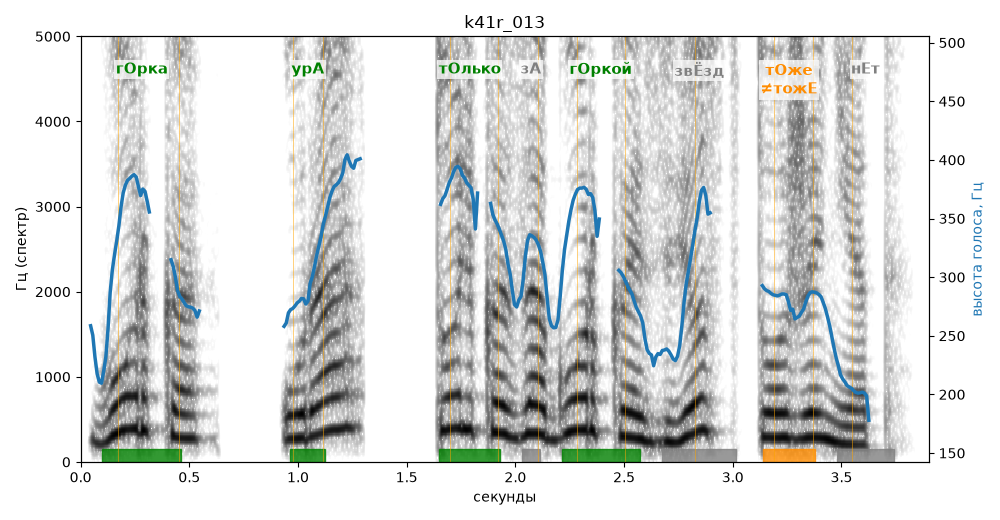

# k41r_013

Эталон: Горка! Ура! Только за горкой звёзд тоже нет.
Распознано: горка, ура, только за горка звезд тоже нет.
Расхождения в словах: «горкой» → «горка»

## Ударения
(где нужно: ruaccent)

| слово | нужно | у голоса | |
|---|---|---|---|
| горка | гОрка | гОрка | ✓ |
| ура | урА | урА | ✓ |
| только | тОлько | тОлько | ✓ |
| горкой | гОркой | гОркой | ✓ |
| тоже | тОже | тожЕ | ✗? возможно — послушать |

## Интонация
- ✓ «только за горкой звёзд тоже нет.» — конец фразы понижается — звучит законченно
- Диапазон голоса 10.6 полутонов (живо), средняя высота 291 Гц

## Паузы и темп
- паузы на своих местах
- Темп 5.0 слога/с (нормально)

_Синяя линия — высота голоса. Над словами заглавная буква — где ударение должно быть; красным — голос поставил не туда (уверенно), оранжевым — возможно._
