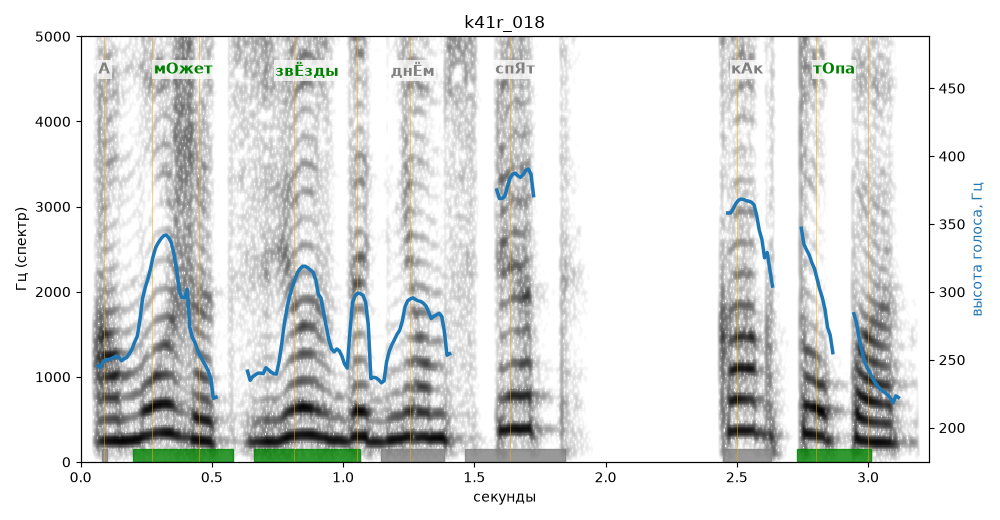

# k41r_018

Эталон: А может, звёзды днём спят? Как Топа!
Распознано: а может звезды днем спят? Как топа?
Слова: все совпали

## Ударения
(где нужно: ruaccent)

| слово | нужно | у голоса | |
|---|---|---|---|
| может | мОжет | мОжет | ✓ |
| звёзды | звЁзды | звЁзды | ✓ |
| топа | тОпа | тОпа | ✓ |

## Интонация
- ✓ «а может звёзды днём спят?» — вопросительный подъём на слове «спят»
- ✓ «как топа!» — выделено слово «как» (+2.7 пт)
- Диапазон голоса 8.6 полутонов (живо), средняя высота 283 Гц

## Паузы и темп
- паузы на своих местах
- Темп 4.3 слога/с (нормально)

_Синяя линия — высота голоса. Над словами заглавная буква — где ударение должно быть; красным — голос поставил не туда (уверенно), оранжевым — возможно._
