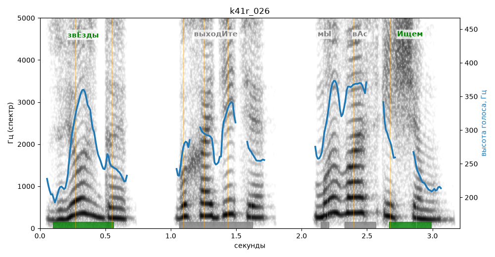

# k41r_026

Эталон: Звёзды! Выходите! Мы вас ищем!
Распознано: звезды, выходите, мы вас ищем.
Слова: все совпали

## Ударения
(где нужно: ruaccent)

| слово | нужно | у голоса | |
|---|---|---|---|
| звёзды | звЁзды | звЁзды | ✓ |
| выходите | выходИте | выходитЕ | ? не разобрать |
| ищем | Ищем | Ищем | ✓ |

## Интонация
- ✗ «выходите!» — восклицание звучит ровно, без эмоции
- ✓ «мы вас ищем!» — выделено слово «вас» (+3.2 пт)
- Диапазон голоса 9.7 полутонов (живо), средняя высота 270 Гц

## Паузы и темп
- паузы на своих местах
- Темп 5.4 слога/с (нормально)

_Синяя линия — высота голоса. Над словами заглавная буква — где ударение должно быть; красным — голос поставил не туда (уверенно), оранжевым — возможно._
