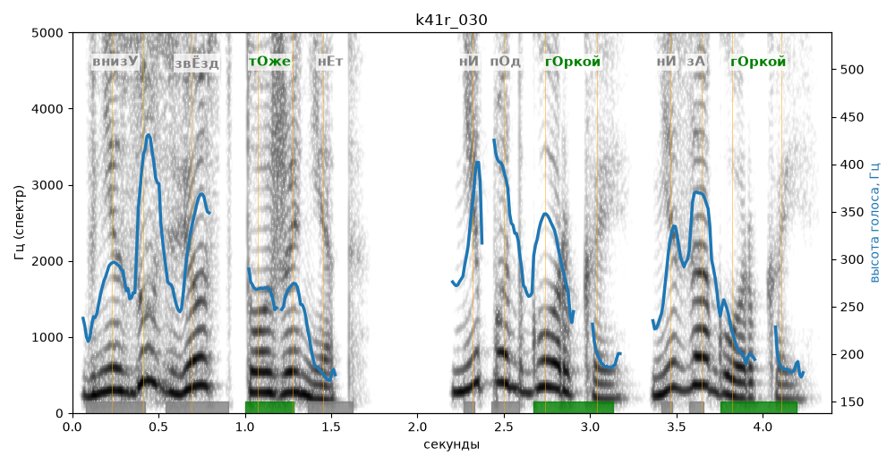

# k41r_030

Эталон: Внизу звёзд тоже нет. Ни под горкой, ни за горкой.
Распознано: Внизу звезд тоже нет. Непод горкой, незагоркой.
Расхождения в словах: «ни под» → «непод»; «ни за горкой» → «незагоркой»

## Ударения
(где нужно: ruaccent)

| слово | нужно | у голоса | |
|---|---|---|---|
| внизу | внизУ | внИзу | ? не разобрать |
| тоже | тОже | тОже | ✓ |
| горкой | гОркой | гОркой | ✓ |
| горкой | гОркой | гОркой | ✓ |

## Интонация
- ✓ «внизу звёзд тоже нет.» — конец фразы понижается — звучит законченно
- ✓ «ни под горкой ни за горкой.» — конец фразы понижается — звучит законченно
- Диапазон голоса 13.4 полутонов (живо), средняя высота 271 Гц

## Паузы и темп
- паузы на своих местах
- Темп 4.4 слога/с (нормально)

_Синяя линия — высота голоса. Над словами заглавная буква — где ударение должно быть; красным — голос поставил не туда (уверенно), оранжевым — возможно._
