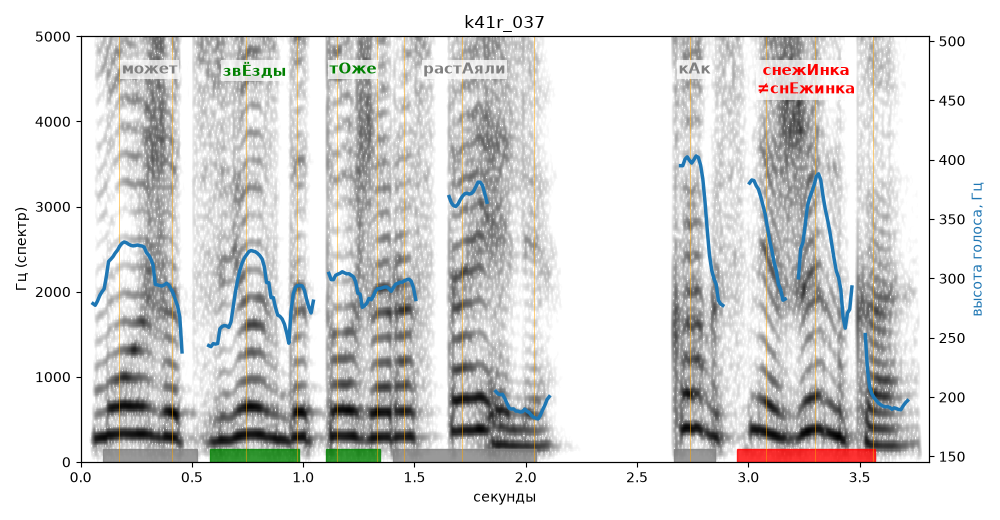

# k41r_037

Эталон: Может, звёзды тоже растаяли? Как снежинка!
Распознано: Может звезда тоже расставили? Как с ней жинка?
Расхождения в словах: «звезды» → «звезда»; «растаяли» → «расставили»; «снежинка» → «с ней жинка»

## Ударения
(где нужно: ruaccent)

| слово | нужно | у голоса | |
|---|---|---|---|
| может | может | мОжет | нет эталона |
| звёзды | звЁзды | звЁзды | ✓ |
| тоже | тОже | тОже | ✓ |
| растаяли | растАяли | — | ? |
| снежинка | снежИнка | снЕжинка | ✗ ОШИБКА |

## Интонация
- ✓ «может звёзды тоже растаяли?» — вопросительный подъём на слове «растаяли»
- ✓ «как снежинка!» — выделено слово «как» (+2.3 пт)
- Диапазон голоса 12.2 полутонов (живо), средняя высота 295 Гц

## Паузы и темп
- паузы на своих местах
- Темп 4.6 слога/с (нормально)

_Синяя линия — высота голоса. Над словами заглавная буква — где ударение должно быть; красным — голос поставил не туда (уверенно), оранжевым — возможно._
