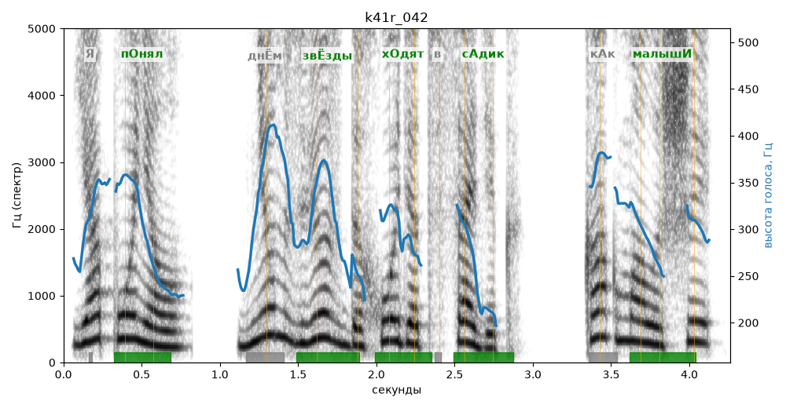

# k41r_042

Эталон: Я понял! Днём звёзды ходят в садик! Как малыши!
Распознано: Я понял, днем звезды ходят в садик. Как малыши?
Слова: все совпали

## Ударения
(где нужно: ruaccent)

| слово | нужно | у голоса | |
|---|---|---|---|
| понял | пОнял | пОнял | ✓ |
| звёзды | звЁзды | звЁзды | ✓ |
| ходят | хОдят | хОдят | ✓ |
| садик | сАдик | сАдик | ✓ |
| малыши | малышИ | малышИ | ✓ |

## Интонация
- ✓ «днём звёзды ходят в садик!» — выделено слово «днём» (+4.2 пт)
- ✓ «как малыши!» — выделено слово «как» (+3.3 пт)
- Диапазон голоса 8.9 полутонов (живо), средняя высота 305 Гц

## Паузы и темп
- паузы на своих местах
- Темп 4.8 слога/с (нормально)

_Синяя линия — высота голоса. Над словами заглавная буква — где ударение должно быть; красным — голос поставил не туда (уверенно), оранжевым — возможно._
