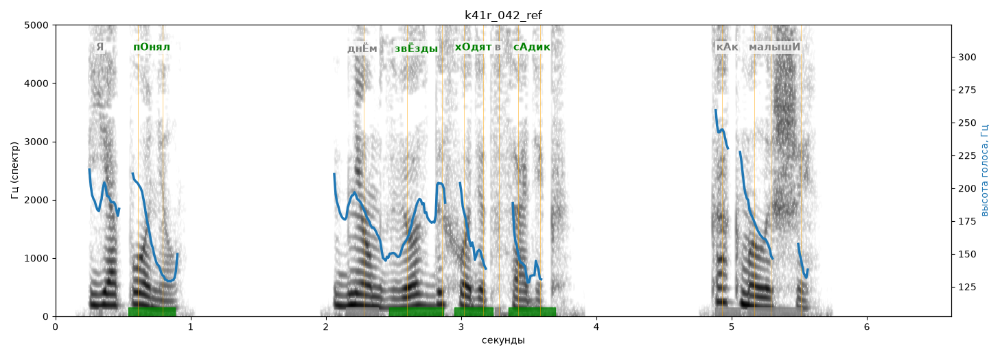

# k41r_042_ref

Голос: **edge:ru-RU-SvetlanaNeural** · длительность 6.6 с
Эталон: Я понял! Днём звёзды ходят в садик! Как малыши!
Распознано: Я понял. Днем звезды ходят в садик. Как малыши.
Слова: все совпали

## Ударения
(где нужно: ruaccent)

| слово | нужно | у голоса | |
|---|---|---|---|
| понял | пОнял | пОнял | ✓ |
| звёзды | звЁзды | звЁзды | ✓ |
| ходят | хОдят | хОдят | ✓ |
| садик | сАдик | сАдик | ✓ |
| малыши | малышИ | малЫши | ? не разобрать |

## Интонация
- ✓ «днём звёзды ходят в садик!» — выделено слово «днём» (+2.4 пт)
- ✓ «как малыши!» — выделено слово «как» (+6.3 пт)
- Диапазон голоса 8.8 полутонов (живо), средняя высота 174 Гц

## Паузы и темп
- паузы на своих местах
- Темп 5.5 слога/с (нормально)

_Синяя линия — высота голоса. Над словами заглавная буква — где ударение должно быть; красным — голос поставил не туда (уверенно), оранжевым — возможно._
