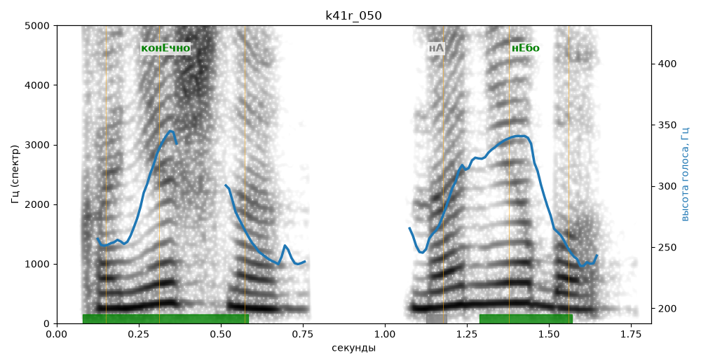

# k41r_050

Эталон: Конечно! На небо!
Распознано: Конечно, на небо.
Слова: все совпали

## Ударения
(где нужно: ruaccent)

| слово | нужно | у голоса | |
|---|---|---|---|
| конечно | конЕчно | конЕчно | ✓ |
| небо | нЕбо | нЕбо | ✓ |

## Интонация
- ✓ «конечно!» — выделено слово «конечно» (+4.1 пт)
- ✓ «на небо!» — выделено слово «небо» (+3.4 пт)
- Диапазон голоса 6.3 полутонов (нормально), средняя высота 267 Гц

## Паузы и темп
- паузы на своих местах
- Темп 6.3 слога/с (нормально)

_Синяя линия — высота голоса. Над словами заглавная буква — где ударение должно быть; красным — голос поставил не туда (уверенно), оранжевым — возможно._
