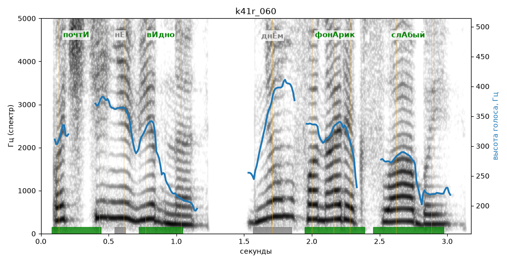

# k41r_060

Эталон: Почти не видно! Днём фонарик слабый!
Распознано: Почти не видно, днем фонарик слабый.
Слова: все совпали

## Ударения
(где нужно: ruaccent)

| слово | нужно | у голоса | |
|---|---|---|---|
| почти | почтИ | почтИ | ✓ |
| видно | вИдно | вИдно | ✓ |
| фонарик | фонАрик | фонАрик | ✓ |
| слабый | слАбый | слАбый | ✓ |

## Интонация
- ✓ «почти не видно!» — выделено слово «почти» (+2.9 пт)
- ✓ «днём фонарик слабый!» — выделено слово «днём» (+3.1 пт)
- Диапазон голоса 11.2 полутонов (живо), средняя высота 306 Гц

## Паузы и темп
- паузы на своих местах
- Темп 4.6 слога/с (нормально)

_Синяя линия — высота голоса. Над словами заглавная буква — где ударение должно быть; красным — голос поставил не туда (уверенно), оранжевым — возможно._
