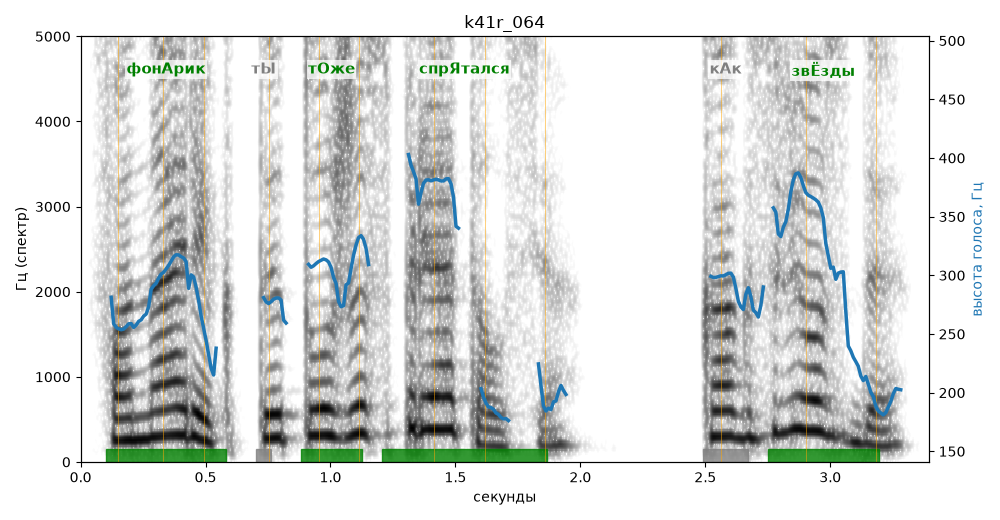

# k41r_064

Эталон: Фонарик, ты тоже спрятался? Как звёзды?
Распознано: Фонарик, ты тоже спрятался? Как звезды?
Слова: все совпали

## Ударения
(где нужно: ruaccent)

| слово | нужно | у голоса | |
|---|---|---|---|
| фонарик | фонАрик | фонАрик | ✓ |
| тоже | тОже | тОже | ✓ |
| спрятался | спрЯтался | спрЯтался | ✓ |
| звёзды | звЁзды | звЁзды | ✓ |

## Интонация
- ✓ «фонарик ты тоже спрятался?» — вопросительный подъём на слове «спрятался»
- ✗ «как звёзды?» — конец фразы не понижается — звучит незаконченно / как перечисление
- Диапазон голоса 12.6 полутонов (живо), средняя высота 290 Гц

## Паузы и темп
- паузы на своих местах
- Темп 4.9 слога/с (нормально)

_Синяя линия — высота голоса. Над словами заглавная буква — где ударение должно быть; красным — голос поставил не туда (уверенно), оранжевым — возможно._
