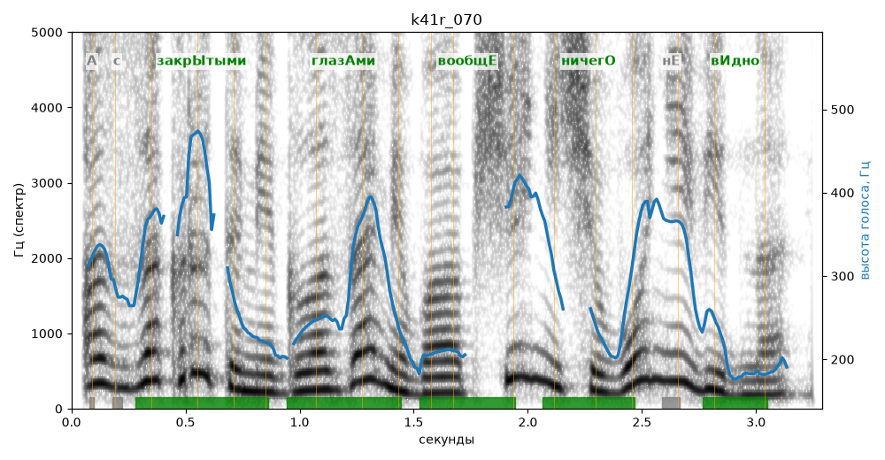

# k41r_070

Эталон: А с закрытыми глазами вообще ничего не видно!
Распознано: А с закрытыми глазами вообще ничего не видно.
Слова: все совпали

## Ударения
(где нужно: ruaccent)

| слово | нужно | у голоса | |
|---|---|---|---|
| закрытыми | закрЫтыми | закрЫтыми | ✓ |
| глазами | глазАми | глазАми | ✓ |
| вообще | вообщЕ | вообщЕ | ✓ |
| ничего | ничегО | ничегО | ✓ |
| видно | вИдно | вИдно | ✓ |

## Интонация
- ✓ «а с закрытыми глазами вообще ничего не видно!» — выделено слово «закрытыми» (+8.3 пт)
- Диапазон голоса 14.1 полутонов (живо), средняя высота 260 Гц

## Паузы и темп
- паузы на своих местах
- Темп 6.1 слога/с (нормально)

_Синяя линия — высота голоса. Над словами заглавная буква — где ударение должно быть; красным — голос поставил не туда (уверенно), оранжевым — возможно._
