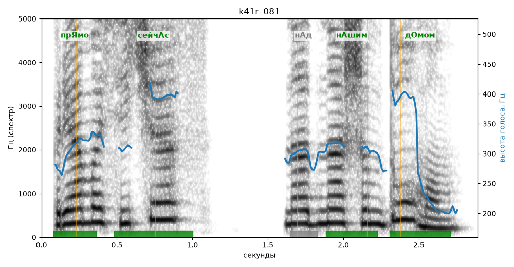

# k41r_081

Эталон: Прямо сейчас? Над нашим домом?
Распознано: прямо сейчас на нашим домом.
Расхождения в словах: «над» → «на»

## Ударения
(где нужно: ruaccent)

| слово | нужно | у голоса | |
|---|---|---|---|
| прямо | прЯмо | прЯмо | ✓ |
| сейчас | сейчАс | сейчАс | ✓ |
| нашим | нАшим | нАшим | ✓ |
| домом | дОмом | дОмом | ✓ |

## Интонация
- ✓ «прямо сейчас?» — вопросительный подъём на слове «сейчас»
- ✓ «над нашим домом?» — вопросительный подъём на слове «домом»
- Диапазон голоса 11.6 полутонов (живо), средняя высота 308 Гц

## Паузы и темп
- паузы на своих местах
- Темп 4.5 слога/с (нормально)

_Синяя линия — высота голоса. Над словами заглавная буква — где ударение должно быть; красным — голос поставил не туда (уверенно), оранжевым — возможно._
