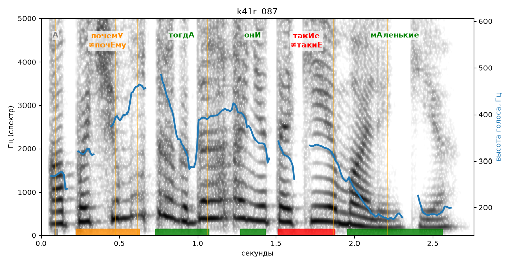

# k41r_087

Эталон: А почему тогда они такие маленькие?
Распознано: А почему тогда они такие маленькие?
Слова: все совпали

## Ударения
(где нужно: ruaccent)

| слово | нужно | у голоса | |
|---|---|---|---|
| почему | почемУ | почЕму | ✗? возможно — послушать |
| тогда | тогдА | тогдА | ✓ |
| они | онИ | онИ | ✓ |
| такие | такИе | такиЕ | ✗ ОШИБКА |
| маленькие | мАленькие | мАленькие | ✓ |

## Интонация
- ✗ «а почему тогда они такие маленькие?» — нет вопросительного подъёма (самое высокое место — «почему», в начале) — звучит как утверждение
- Диапазон голоса 15.8 полутонов (живо), средняя высота 321 Гц

## Паузы и темп
- паузы на своих местах
- Темп 6.6 слога/с (быстро)

_Синяя линия — высота голоса. Над словами заглавная буква — где ударение должно быть; красным — голос поставил не туда (уверенно), оранжевым — возможно._
