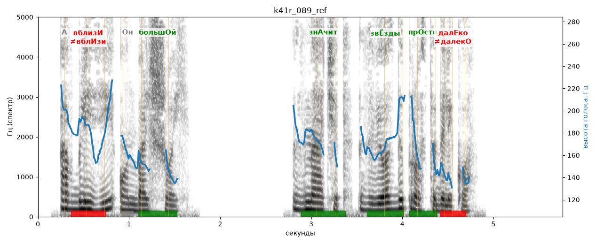

# k41r_089_ref

Голос: **edge:ru-RU-SvetlanaNeural** · длительность 5.8 с
Эталон: А вблизи он большой! Значит, звёзды просто далеко!
Распознано: А вблизи он большой. Значит, звезды просто далеко.
Слова: все совпали

## Ударения
(где нужно: ruaccent)

| слово | нужно | у голоса | |
|---|---|---|---|
| вблизи | вблизИ | вблИзи | ✗ ОШИБКА |
| большой | большОй | большОй | ✓ |
| значит | знАчит | знАчит | ✓ |
| звёзды | звЁзды | звЁзды | ✓ |
| просто | прОсто | прОсто | ✓ |
| далеко | далЕко | далекО | ✗ ОШИБКА |

## Интонация
- ✓ «а вблизи он большой!» — выделено слово «а» (+2.2 пт)
- ✓ «значит звёзды просто далеко!» — выделено слово «значит» (+2.0 пт)
- Диапазон голоса 7.3 полутонов (живо), средняя высота 169 Гц

## Паузы и темп
- паузы на своих местах
- Темп 5.7 слога/с (нормально)

_Синяя линия — высота голоса. Над словами заглавная буква — где ударение должно быть; красным — голос поставил не туда (уверенно), оранжевым — возможно._
