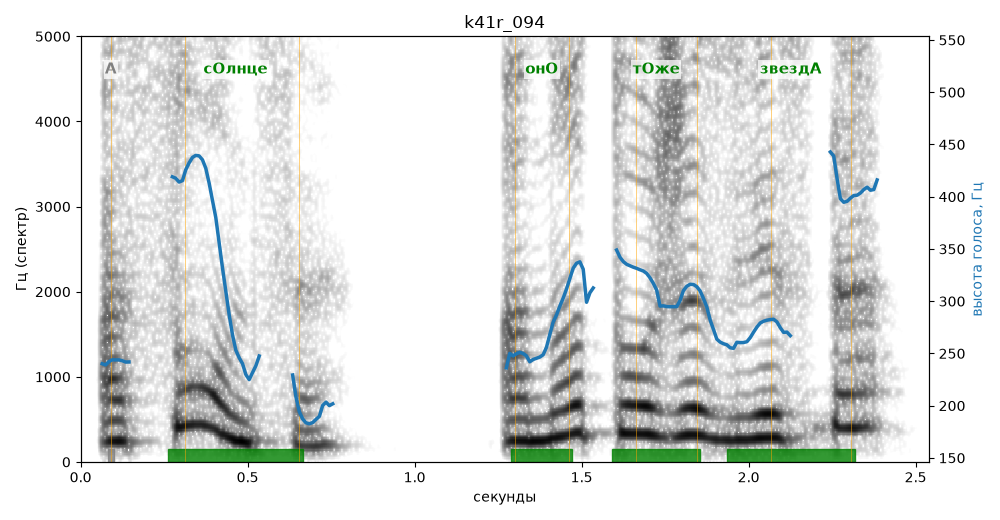

# k41r_094

Эталон: А солнце? Оно тоже звезда?
Распознано: А солнце. А оно тоже звезда.
Расхождения в словах: «» → «а»

## Ударения
(где нужно: ruaccent)

| слово | нужно | у голоса | |
|---|---|---|---|
| солнце | сОлнце | сОлнце | ✓ |
| оно | онО | онО | ✓ |
| тоже | тОже | тОже | ✓ |
| звезда | звездА | звездА | ✓ |

## Интонация
- ✓ «а солнце?» — вопросительный подъём на слове «солнце»
- ✓ «оно тоже звезда?» — вопросительный подъём на слове «звезда»
- Диапазон голоса 13.1 полутонов (живо), средняя высота 287 Гц

## Паузы и темп
- паузы на своих местах
- Темп 6.2 слога/с (нормально)

_Синяя линия — высота голоса. Над словами заглавная буква — где ударение должно быть; красным — голос поставил не туда (уверенно), оранжевым — возможно._
