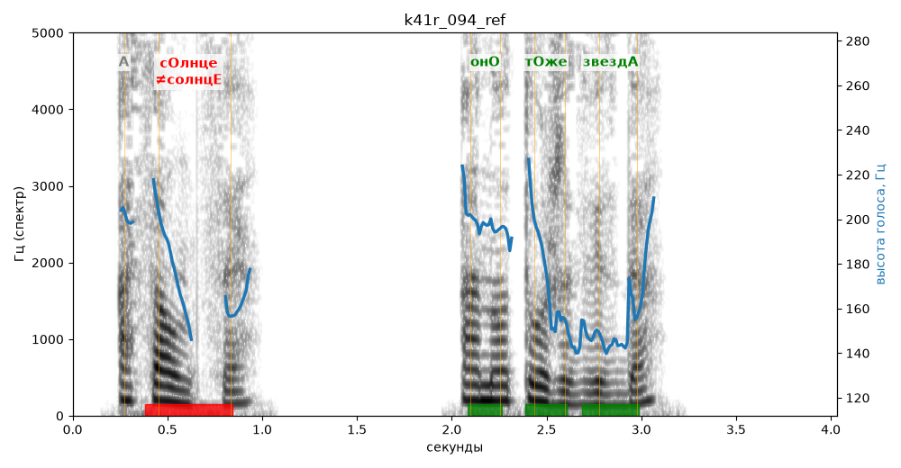

# k41r_094_ref

Голос: **edge:ru-RU-SvetlanaNeural** · длительность 4.0 с
Эталон: А с+олнце? Оно тоже звезда?
Распознано: Асалнцы. Оно тоже звезда.
Расхождения в словах: «а солнце» → «асалнцы»

## Ударения
(где нужно: ruaccent)

| слово | нужно | у голоса | |
|---|---|---|---|
| солнце | сОлнце | солнцЕ | ✗ ОШИБКА |
| оно | онО | онО | ✓ |
| тоже | тОже | тОже | ✓ |
| звезда | звездА | звездА | ✓ |

## Интонация
- ✗ «а солнце?» — нет вопросительного подъёма (самое высокое место — «а», в начале) — звучит как утверждение
- ✗ «оно тоже звезда?» — нет вопросительного подъёма (самое высокое место — «оно», в начале) — звучит как утверждение
- Диапазон голоса 6.5 полутонов (нормально), средняя высота 169 Гц

## Паузы и темп
- паузы на своих местах
- Темп 6.1 слога/с (нормально)

_Синяя линия — высота голоса. Над словами заглавная буква — где ударение должно быть; красным — голос поставил не туда (уверенно), оранжевым — возможно._
