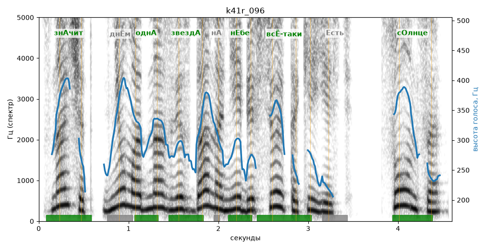

# k41r_096

Эталон: Значит, днём одна звезда на небе всё-таки есть! Солнце!
Распознано: Значит, в нем одна звезда на небе все-таки есть. Солнце!
Расхождения в словах: «днем» → «в нем»

## Ударения
(где нужно: ruaccent)

| слово | нужно | у голоса | |
|---|---|---|---|
| значит | знАчит | знАчит | ✓ |
| одна | однА | однА | ✓ |
| звезда | звездА | звездА | ✓ |
| небе | нЕбе | нЕбе | ✓ |
| всё-таки | всЁ-таки | всЁ-таки | ✓ |
| солнце | сОлнце | сОлнце | ✓ |

## Интонация
- ✓ «значит днём одна звезда на небе всё-таки есть!» — выделено слово «значит» (+4.9 пт)
- Диапазон голоса 9.1 полутонов (живо), средняя высота 294 Гц

## Паузы и темп
- паузы на своих местах
- Темп 4.4 слога/с (нормально)

_Синяя линия — высота голоса. Над словами заглавная буква — где ударение должно быть; красным — голос поставил не туда (уверенно), оранжевым — возможно._
