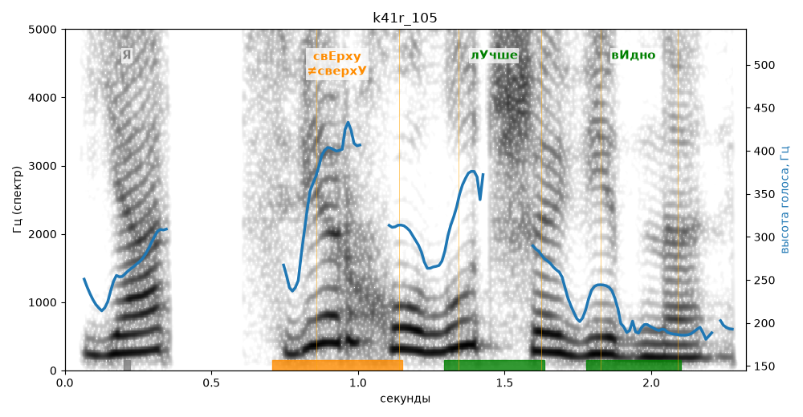

# k41r_105

Эталон: Я! Сверху лучше видно!
Распознано: Я сверху лучше видно.
Слова: все совпали

## Ударения
(где нужно: ruaccent)

| слово | нужно | у голоса | |
|---|---|---|---|
| сверху | свЕрху | сверхУ | ✗? возможно — послушать |
| лучше | лУчше | лУчше | ✓ |
| видно | вИдно | вИдно | ✓ |

## Интонация
- ✓ «сверху лучше видно!» — выделено слово «сверху» (+5.6 пт)
- Диапазон голоса 13.2 полутонов (живо), средняя высота 260 Гц

## Паузы и темп
- паузы на своих местах
- Темп 4.2 слога/с (нормально)

_Синяя линия — высота голоса. Над словами заглавная буква — где ударение должно быть; красным — голос поставил не туда (уверенно), оранжевым — возможно._
