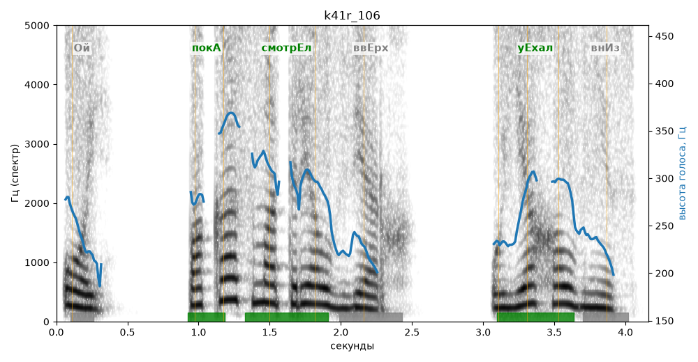

# k41r_106

Эталон: Ой. Пока смотрел вверх, уехал вниз!
Распознано: Ой, пока смотрел вверх. Уехал вниз.
Слова: все совпали

## Ударения
(где нужно: ruaccent)

| слово | нужно | у голоса | |
|---|---|---|---|
| пока | покА | покА | ✓ |
| смотрел | смотрЕл | смотрЕл | ✓ |
| уехал | уЕхал | уЕхал | ✓ |

## Интонация
- ✓ «пока смотрел вверх уехал вниз!» — выделено слово «пока» (+4.1 пт)
- Диапазон голоса 9.1 полутонов (живо), средняя высота 266 Гц

## Паузы и темп
- паузы на своих местах
- Темп 3.9 слога/с (медленно)

_Синяя линия — высота голоса. Над словами заглавная буква — где ударение должно быть; красным — голос поставил не туда (уверенно), оранжевым — возможно._
