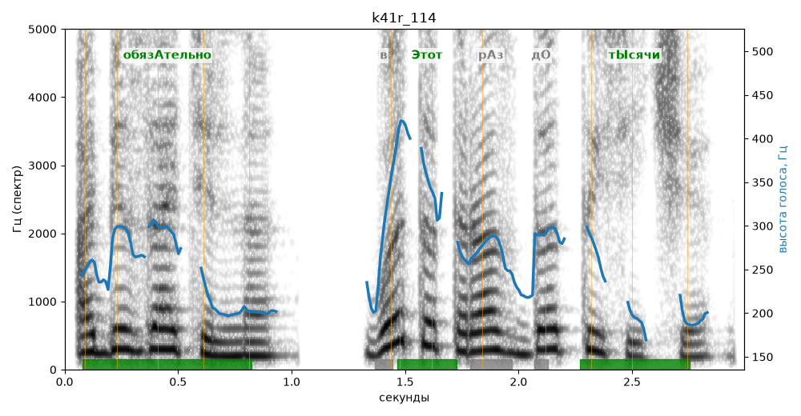

# k41r_114

Эталон: Обязательно! В этот раз до тысячи!
Распознано: Обязательно! В этот раз до тысячи!
Слова: все совпали

## Ударения
(где нужно: ruaccent)

| слово | нужно | у голоса | |
|---|---|---|---|
| обязательно | обязАтельно | обязАтельно | ✓ |
| этот | Этот | Этот | ✓ |
| тысячи | тЫсячи | тЫсячи | ✓ |

## Интонация
- ✓ «обязательно!» — выделено слово «обязательно» (+2.9 пт)
- ✓ «в этот раз до тысячи!» — выделено слово «этот» (+7.2 пт)
- Диапазон голоса 11.4 полутонов (живо), средняя высота 261 Гц

## Паузы и темп
- паузы на своих местах
- Темп 6.1 слога/с (нормально)

_Синяя линия — высота голоса. Над словами заглавная буква — где ударение должно быть; красным — голос поставил не туда (уверенно), оранжевым — возможно._
