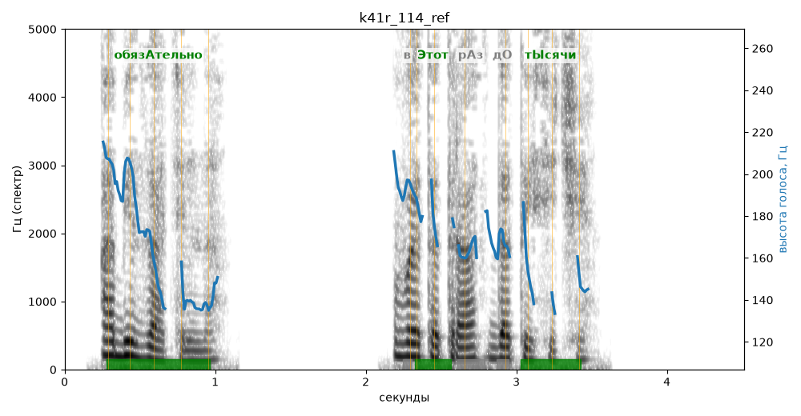

# k41r_114_ref

Голос: **edge:ru-RU-SvetlanaNeural** · длительность 4.5 с
Эталон: Обязательно! В этот раз до тысячи!
Распознано: Обязательно. В этот раз до тысячи.
Слова: все совпали

## Ударения
(где нужно: ruaccent)

| слово | нужно | у голоса | |
|---|---|---|---|
| обязательно | обязАтельно | обязАтельно | ✓ |
| этот | Этот | Этот | ✓ |
| тысячи | тЫсячи | тЫсячи | ✓ |

## Интонация
- ✗ «обязательно!» — восклицание звучит ровно, без эмоции
- ✓ «в этот раз до тысячи!» — выделено слово «в» (+2.9 пт)
- Диапазон голоса 7.3 полутонов (живо), средняя высота 167 Гц

## Паузы и темп
- паузы на своих местах
- Темп 7.0 слога/с (быстро)

_Синяя линия — высота голоса. Над словами заглавная буква — где ударение должно быть; красным — голос поставил не туда (уверенно), оранжевым — возможно._
