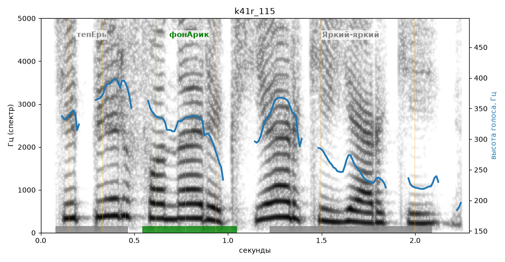

# k41r_115

Эталон: Теперь фонарик яркий-яркий!
Распознано: Теперь фонарик яркий яркий.
Расхождения в словах: «яркий-яркий» → «яркий яркий»

## Ударения
(где нужно: ruaccent)

| слово | нужно | у голоса | |
|---|---|---|---|
| теперь | тепЕрь | — | ? |
| фонарик | фонАрик | фонАрик | ✓ |
| яркий-яркий | Яркий-яркий | — | ? |

## Интонация
- ✓ «теперь фонарик яркий-яркий!» — выделено слово «теперь» (+2.2 пт)
- Диапазон голоса 9.9 полутонов (живо), средняя высота 314 Гц

## Паузы и темп
- паузы на своих местах
- Темп 4.4 слога/с (нормально)

_Синяя линия — высота голоса. Над словами заглавная буква — где ударение должно быть; красным — голос поставил не туда (уверенно), оранжевым — возможно._
