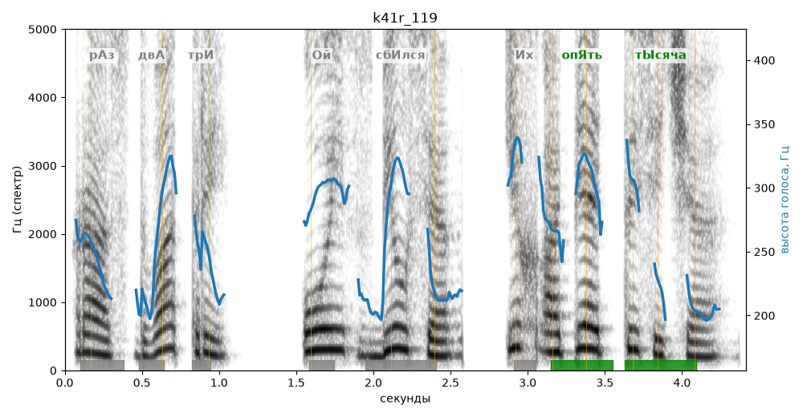

# k41r_119

Эталон: Раз, два, три… Ой, сбился! Их опять тысяча!
Распознано: Раз, два, три. Ой, сбился. Их опять тысяча.
Слова: все совпали

## Ударения
(где нужно: ruaccent)

| слово | нужно | у голоса | |
|---|---|---|---|
| сбился | сбИлся | сбилсЯ | ? не разобрать |
| опять | опЯть | опЯть | ✓ |
| тысяча | тЫсяча | тЫсяча | ✓ |

## Интонация
- ✓ «раз два три…» — конец фразы понижается — звучит законченно
- ✗ «ой сбился!» — восклицание звучит ровно, без эмоции
- ✓ «их опять тысяча!» — выделено слово «их» (+2.3 пт)
- Диапазон голоса 8.3 полутонов (живо), средняя высота 261 Гц

## Паузы и темп
- паузы на своих местах
- Темп 4.9 слога/с (нормально)

_Синяя линия — высота голоса. Над словами заглавная буква — где ударение должно быть; красным — голос поставил не туда (уверенно), оранжевым — возможно._
