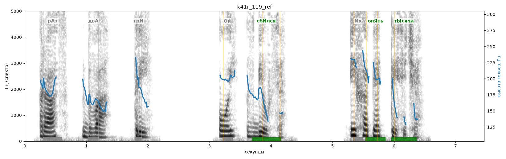

# k41r_119_ref

Голос: **edge:ru-RU-SvetlanaNeural** · длительность 7.5 с
Эталон: Раз, два, три… Ой, сбился! Их опять тысяча!
Распознано: 1, 2, 3. Ой, сбился. Их опять тысяча.
Расхождения в словах: «раз два три» → «1 2 3»

## Ударения
(где нужно: ruaccent)

| слово | нужно | у голоса | |
|---|---|---|---|
| сбился | сбИлся | сбИлся | ✓ |
| опять | опЯть | опЯть | ✓ |
| тысяча | тЫсяча | тЫсяча | ✓ |

## Интонация
- ✗ «раз два три…» — конец фразы не понижается — звучит незаконченно / как перечисление
- ✓ «ой сбился!» — выделено слово «ой» (+2.9 пт)
- ✓ «их опять тысяча!» — выделено слово «их» (+4.5 пт)
- Диапазон голоса 8.3 полутонов (живо), средняя высота 179 Гц

## Паузы и темп
- паузы на своих местах
- Темп 5.3 слога/с (нормально)

_Синяя линия — высота голоса. Над словами заглавная буква — где ударение должно быть; красным — голос поставил не туда (уверенно), оранжевым — возможно._
