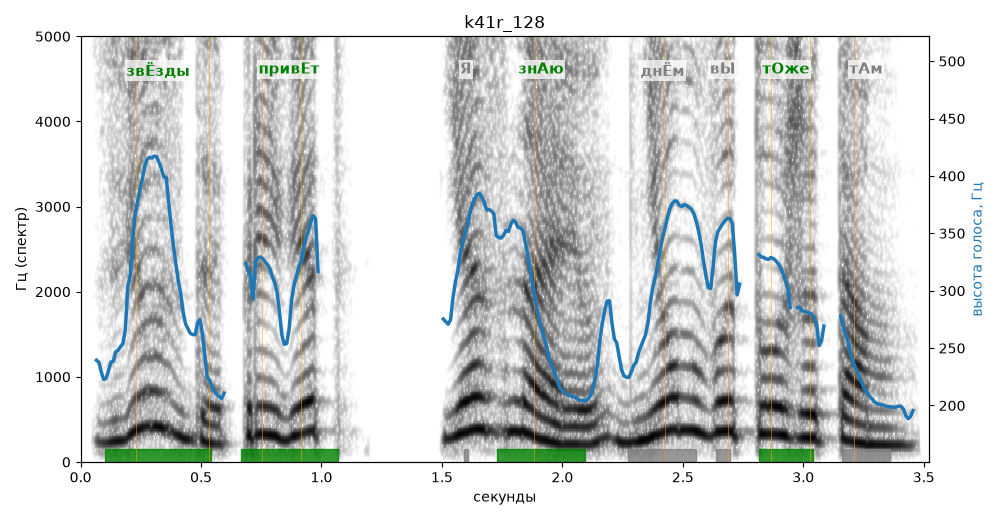

# k41r_128

Эталон: Звёзды, привет! Я знаю, днём вы тоже там!
Распознано: Звезда, привет! Я знаю, днем вы тоже там.
Расхождения в словах: «звезды» → «звезда»

## Ударения
(где нужно: ruaccent)

| слово | нужно | у голоса | |
|---|---|---|---|
| звёзды | звЁзды | звЁзды | ✓ |
| привет | привЕт | привЕт | ✓ |
| знаю | знАю | знАю | ✓ |
| тоже | тОже | тОже | ✓ |

## Интонация
- ✓ «звёзды привет!» — выделено слово «звёзды» (+3.6 пт)
- ✗ «я знаю днём вы тоже там!» — восклицание звучит ровно, без эмоции
- Диапазон голоса 11.2 полутонов (живо), средняя высота 292 Гц

## Паузы и темп
- паузы на своих местах
- Темп 3.9 слога/с (медленно)

_Синяя линия — высота голоса. Над словами заглавная буква — где ударение должно быть; красным — голос поставил не туда (уверенно), оранжевым — возможно._
