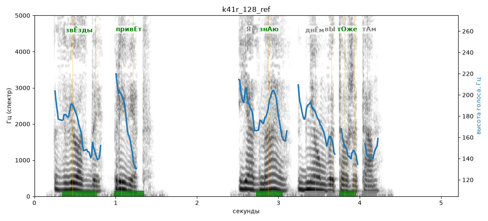

# k41r_128_ref

Голос: **edge:ru-RU-SvetlanaNeural** · длительность 5.2 с
Эталон: Звёзды, привет! Я знаю, днём вы тоже там!
Распознано: Звезды, привет! Я знаю, днем вы тоже там.
Слова: все совпали

## Ударения
(где нужно: ruaccent)

| слово | нужно | у голоса | |
|---|---|---|---|
| звёзды | звЁзды | звЁзды | ✓ |
| привет | привЕт | привЕт | ✓ |
| знаю | знАю | знАю | ✓ |
| тоже | тОже | тОже | ✓ |

## Интонация
- ✗ «звёзды привет!» — восклицание звучит ровно, без эмоции
- ✓ «я знаю днём вы тоже там!» — выделено слово «знаю» (+3.2 пт)
- Диапазон голоса 6.5 полутонов (нормально), средняя высота 173 Гц

## Паузы и темп
- паузы на своих местах
- Темп 4.8 слога/с (нормально)

_Синяя линия — высота голоса. Над словами заглавная буква — где ударение должно быть; красным — голос поставил не туда (уверенно), оранжевым — возможно._
