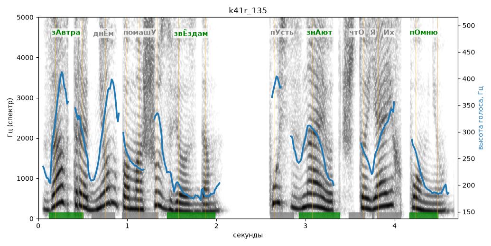

# k41r_135

Эталон: Завтра днём помашу звёздам. Пусть знают, что я их помню!
Распознано: Завтра днём по мошу звёздам. Пусть знают, что я их помню.
Расхождения в словах: «помашу» → «по мошу»

## Ударения
(где нужно: ruaccent)

| слово | нужно | у голоса | |
|---|---|---|---|
| завтра | зАвтра | зАвтра | ✓ |
| помашу | помашУ | помАшу | ? не разобрать |
| звёздам | звЁздам | звЁздам | ✓ |
| знают | знАют | знАют | ✓ |
| помню | пОмню | пОмню | ✓ |

## Интонация
- ✓ «завтра днём помашу звёздам.» — конец фразы понижается — звучит законченно
- ✓ «пусть знают что я их помню!» — выделено слово «пусть» (+6.3 пт)
- Диапазон голоса 13.2 полутонов (живо), средняя высота 246 Гц

## Паузы и темп
- паузы на своих местах
- Темп 3.7 слога/с (медленно)

_Синяя линия — высота голоса. Над словами заглавная буква — где ударение должно быть; красным — голос поставил не туда (уверенно), оранжевым — возможно._
