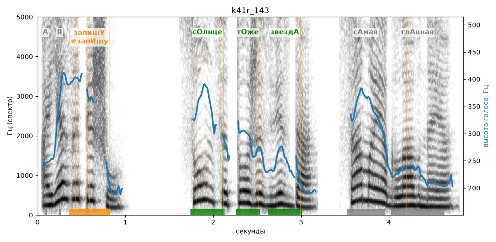

# k41r_143

Эталон: А я запишу: солнце тоже звезда! Самая главная!
Распознано: А я запишу. Солнце тоже звезда. Самая главная.
Слова: все совпали

## Ударения
(где нужно: ruaccent)

| слово | нужно | у голоса | |
|---|---|---|---|
| запишу | запишУ | запИшу | ✗? возможно — послушать |
| солнце | сОлнце | сОлнце | ✓ |
| тоже | тОже | тОже | ✓ |
| звезда | звездА | звездА | ✓ |
| самая | сАмая | — | ? |
| главная | глАвная | — | ? |

## Интонация
- ✓ «а я запишу солнце тоже звезда!» — выделено слово «солнце» (+5.0 пт)
- ✓ «самая главная!» — выделено слово «самая» (+3.9 пт)
- Диапазон голоса 12.5 полутонов (живо), средняя высота 256 Гц

## Паузы и темп
- паузы на своих местах
- Темп 4.5 слога/с (нормально)

_Синяя линия — высота голоса. Над словами заглавная буква — где ударение должно быть; красным — голос поставил не туда (уверенно), оранжевым — возможно._
