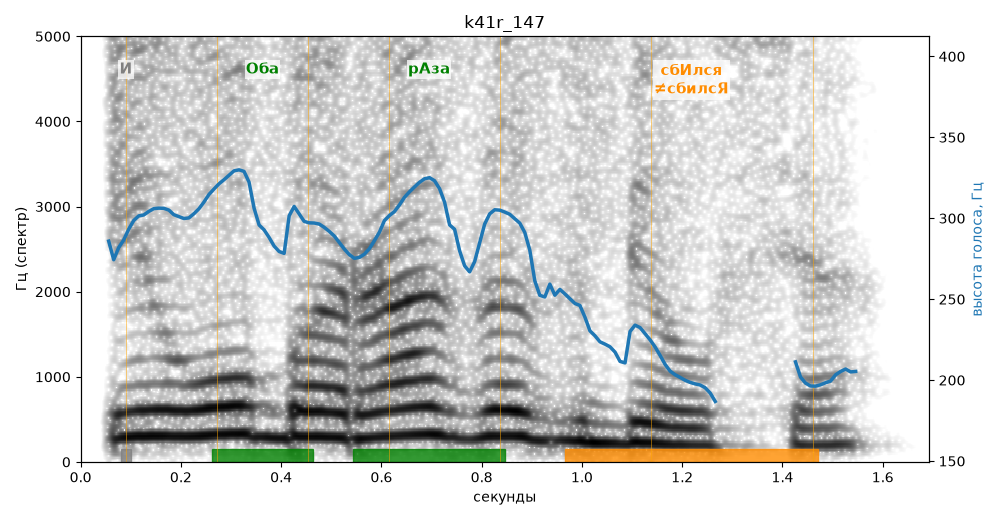

# k41r_147

Эталон: И оба раза сбился.
Распознано: и оба разозбился.
Расхождения в словах: «раза сбился» → «разозбился»

## Ударения
(где нужно: ruaccent)

| слово | нужно | у голоса | |
|---|---|---|---|
| оба | Оба | Оба | ✓ |
| раза | рАза | рАза | ✓ |
| сбился | сбИлся | сбилсЯ | ✗? возможно — послушать |

## Интонация
- ✓ «и оба раза сбился.» — конец фразы понижается — звучит законченно
- Диапазон голоса 8.5 полутонов (живо), средняя высота 285 Гц

## Паузы и темп
- паузы на своих местах
- Темп 5.7 слога/с (нормально)

_Синяя линия — высота голоса. Над словами заглавная буква — где ударение должно быть; красным — голос поставил не туда (уверенно), оранжевым — возможно._
