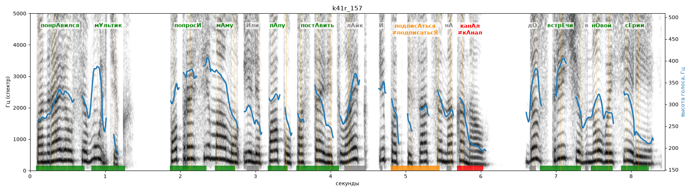

# k41r_157

Эталон: Понравился мультик? Попроси маму или папу поставить лайк и подписаться на канал. До встречи в новой серии!
Распознано: Понравился мультик? Попроси маму или папу поставить лайк и подписаться на канал. До встречи в новой серии!
Слова: все совпали

## Ударения
(где нужно: ruaccent)

| слово | нужно | у голоса | |
|---|---|---|---|
| понравился | понрАвился | понрАвился | ✓ |
| мультик | мУльтик | мУльтик | ✓ |
| попроси | попросИ | попросИ | ✓ |
| маму | мАму | мАму | ✓ |
| или | Или | илИ | ? не разобрать |
| папу | пАпу | пАпу | ✓ |
| поставить | постАвить | постАвить | ✓ |
| подписаться | подписАться | подписатьсЯ | ✗? возможно — послушать |
| канал | канАл | кАнал | ✗ ОШИБКА |
| встречи | встрЕчи | встрЕчи | ✓ |
| новой | нОвой | нОвой | ✓ |
| серии | сЕрии | сЕрии | ✓ |

## Интонация
- ✓ «понравился мультик?» — вопросительный подъём на слове «мультик»
- ✓ «попроси маму или папу поставить лайк и подписаться на канал.» — конец фразы понижается — звучит законченно
- ✓ «до встречи в новой серии!» — выделено слово «встречи» (+5.1 пт)
- Диапазон голоса 10.3 полутонов (живо), средняя высота 292 Гц

## Паузы и темп
- паузы на своих местах
- Темп 5.5 слога/с (нормально)

_Синяя линия — высота голоса. Над словами заглавная буква — где ударение должно быть; красным — голос поставил не туда (уверенно), оранжевым — возможно._
