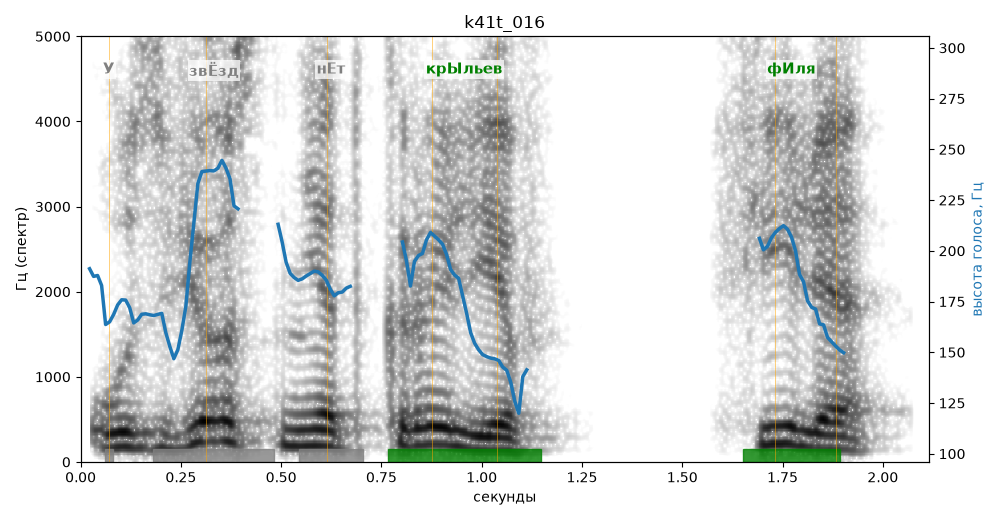

# k41t_016

Эталон: У звёзд нет крыльев, Филя!
Распознано: Узвезд нет крыльев, Фили.
Расхождения в словах: «у звезд» → «узвезд»; «филя» → «фили»

## Ударения
(где нужно: ruaccent)

| слово | нужно | у голоса | |
|---|---|---|---|
| крыльев | крЫльев | крЫльев | ✓ |
| филя | фИля | фИля | ✓ |

## Интонация
- ✓ «у звёзд нет крыльев филя!» — выделено слово «звёзд» (+2.9 пт)
- Диапазон голоса 9.0 полутонов (живо), средняя высота 183 Гц

## Паузы и темп
- паузы на своих местах
- Темп 5.3 слога/с (нормально)

_Синяя линия — высота голоса. Над словами заглавная буква — где ударение должно быть; красным — голос поставил не туда (уверенно), оранжевым — возможно._
