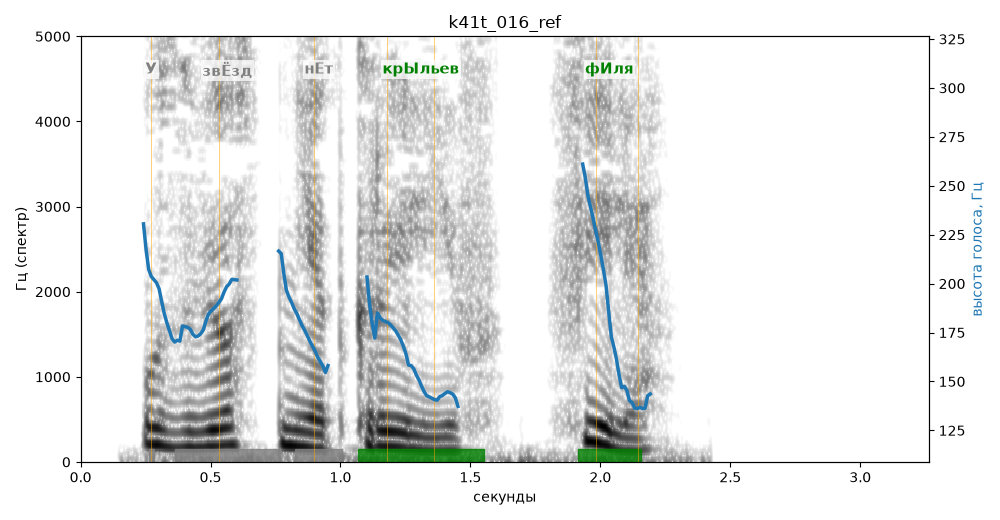

# k41t_016_ref

Голос: **edge:ru-RU-SvetlanaNeural** · длительность 3.3 с
Эталон: У звёзд нет крыльев, Филя!
Распознано: Узвезд не открыли, Филив.
Расхождения в словах: «у звезд нет крыльев филя» → «узвезд не открыли филив»

## Ударения
(где нужно: ruaccent)

| слово | нужно | у голоса | |
|---|---|---|---|
| крыльев | крЫльев | крЫльев | ✓ |
| филя | фИля | фИля | ✓ |

## Интонация
- ✓ «у звёзд нет крыльев филя!» — выделено слово «филя» (+3.4 пт)
- Диапазон голоса 8.5 полутонов (живо), средняя высота 176 Гц

## Паузы и темп
- паузы на своих местах
- Темп 4.6 слога/с (нормально)

_Синяя линия — высота голоса. Над словами заглавная буква — где ударение должно быть; красным — голос поставил не туда (уверенно), оранжевым — возможно._
