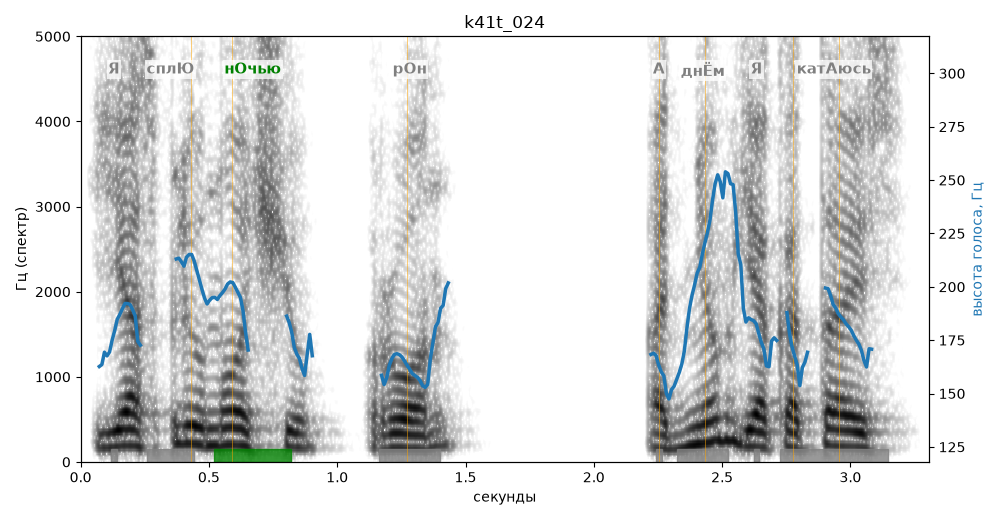

# k41t_024

Эталон: Я сплю ночью, Рон. А днём я катаюсь!
Распознано: Я сплю ночью, Рон, однём я катаюсь.
Расхождения в словах: «а днем» → «однем»

## Ударения
(где нужно: ruaccent)

| слово | нужно | у голоса | |
|---|---|---|---|
| ночью | нОчью | нОчью | ✓ |
| катаюсь | катАюсь | — | ? |

## Интонация
- ✓ «я сплю ночью рон.» — конец фразы понижается — звучит законченно
- ✓ «а днём я катаюсь!» — выделено слово «днём» (+4.6 пт)
- Диапазон голоса 7.7 полутонов (живо), средняя высота 181 Гц

## Паузы и темп
- паузы на своих местах
- Темп 3.8 слога/с (медленно)

_Синяя линия — высота голоса. Над словами заглавная буква — где ударение должно быть; красным — голос поставил не туда (уверенно), оранжевым — возможно._
