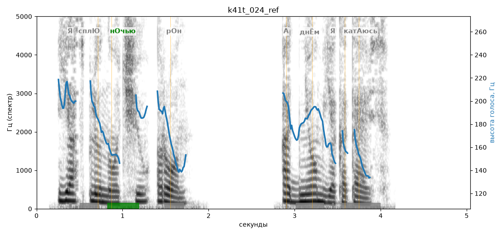

# k41t_024_ref

Голос: **edge:ru-RU-SvetlanaNeural** · длительность 5.0 с
Эталон: Я сплю ночью, Рон. А днём я катаюсь!
Распознано: Я сплю ночью Рон. Однем я катаюсь.
Расхождения в словах: «а днем» → «однем»

## Ударения
(где нужно: ruaccent)

| слово | нужно | у голоса | |
|---|---|---|---|
| ночью | нОчью | нОчью | ✓ |
| катаюсь | катАюсь | — | ? |

## Интонация
- ✗ «я сплю ночью рон.» — конец фразы не понижается — звучит незаконченно / как перечисление
- ✗ «а днём я катаюсь!» — восклицание звучит ровно, без эмоции
- Диапазон голоса 6.7 полутонов (нормально), средняя высота 179 Гц

## Паузы и темп
- паузы на своих местах
- Темп 3.3 слога/с (медленно)

_Синяя линия — высота голоса. Над словами заглавная буква — где ударение должно быть; красным — голос поставил не туда (уверенно), оранжевым — возможно._
