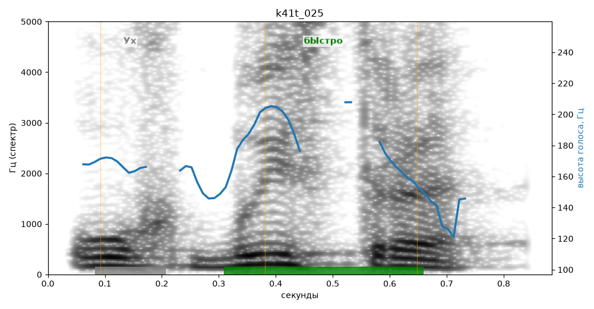

# k41t_025

Эталон: Ух! Быстро!
Распознано: Ух, быстро!
Слова: все совпали

## Ударения
(где нужно: ruaccent)

| слово | нужно | у голоса | |
|---|---|---|---|
| быстро | бЫстро | бЫстро | ✓ |

## Интонация
- Диапазон голоса 7.2 полутонов (живо), средняя высота 166 Гц

## Паузы и темп
- после «ух!» пауза всего 0.10 с — фразы слипаются
- Темп 5.2 слога/с (нормально)

_Синяя линия — высота голоса. Над словами заглавная буква — где ударение должно быть; красным — голос поставил не туда (уверенно), оранжевым — возможно._
