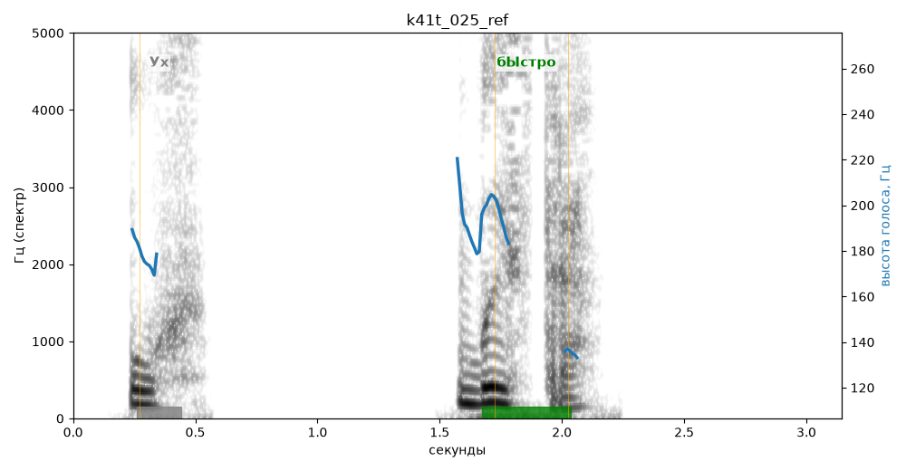

# k41t_025_ref

Голос: **edge:ru-RU-SvetlanaNeural** · длительность 3.1 с
Эталон: Ух! Быстро!
Распознано: Ух! Быстро!
Слова: все совпали

## Ударения
(где нужно: ruaccent)

| слово | нужно | у голоса | |
|---|---|---|---|
| быстро | бЫстро | бЫстро | ✓ |

## Интонация
- Диапазон голоса 7.2 полутонов (живо), средняя высота 184 Гц

## Паузы и темп
- паузы на своих местах
- Темп 5.5 слога/с (нормально)

_Синяя линия — высота голоса. Над словами заглавная буква — где ударение должно быть; красным — голос поставил не туда (уверенно), оранжевым — возможно._
