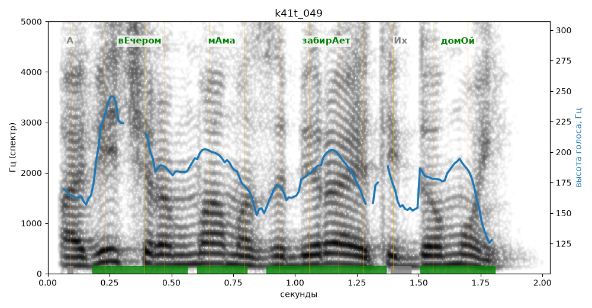

# k41t_049

Эталон: А вечером мама забирает их домой?
Распознано: А вечером мама забирает и домой.
Расхождения в словах: «их» → «и»

## Ударения
(где нужно: ruaccent)

| слово | нужно | у голоса | |
|---|---|---|---|
| вечером | вЕчером | вЕчером | ✓ |
| мама | мАма | мАма | ✓ |
| забирает | забирАет | забирАет | ✓ |
| домой | домОй | домОй | ✓ |

## Интонация
- ✗ «а вечером мама забирает их домой?» — нет вопросительного подъёма (самое высокое место — «вечером», в начале) — звучит как утверждение
- Диапазон голоса 6.6 полутонов (нормально), средняя высота 181 Гц

## Паузы и темп
- паузы на своих местах
- Темп 7.5 слога/с (быстро)

_Синяя линия — высота голоса. Над словами заглавная буква — где ударение должно быть; красным — голос поставил не туда (уверенно), оранжевым — возможно._
