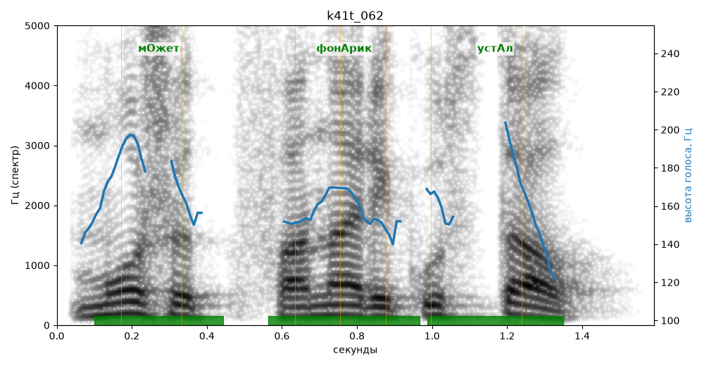

# k41t_062

Эталон: Может, фонарик устал?
Распознано: Может, фанарик устал?
Расхождения в словах: «фонарик» → «фанарик»

## Ударения
(где нужно: ruaccent)

| слово | нужно | у голоса | |
|---|---|---|---|
| может | мОжет | мОжет | ✓ |
| фонарик | фонАрик | фонАрик | ✓ |
| устал | устАл | устАл | ✓ |

## Интонация
- ✗ «может фонарик устал?» — нет вопросительного подъёма (самое высокое место — «может», в начале) — звучит как утверждение
- Диапазон голоса 5.8 полутонов (нормально), средняя высота 159 Гц

## Паузы и темп
- паузы на своих местах
- Темп 5.6 слога/с (нормально)

_Синяя линия — высота голоса. Над словами заглавная буква — где ударение должно быть; красным — голос поставил не туда (уверенно), оранжевым — возможно._
